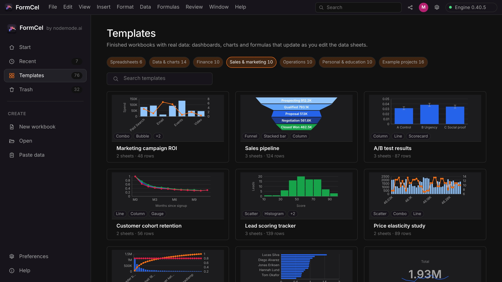
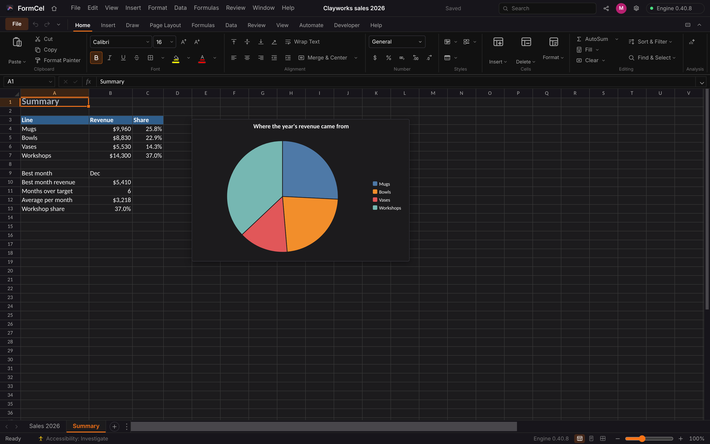
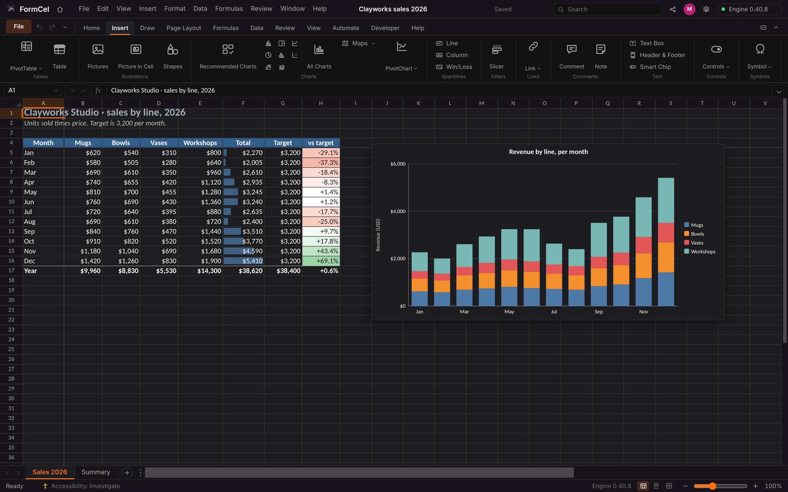
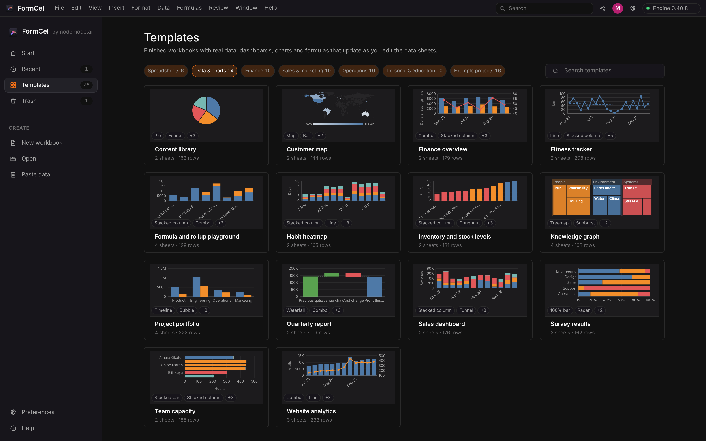

<p align="center">
  
</p>

<h1 align="center">FormCel</h1>

<p align="center">
  <b>Spreadsheets; an open workbook editor for the Form family.</b><br>
  Formulas, charts, PivotTables, tables and Excel and CSV files,<br>
  in one window with no account. Local-first, and yours.
</p>

<p align="center">
  
  
  
  
  
  
</p>

<p align="center">
  <a href="https://formcel.formai.studio/"><b>Download FormCel on formai.studio</b></a> ·
  <a href="#run-it-from-source">Run it from source</a>
</p>

<br>

<p align="center">
  
  <br>
  <sub>Templates: finished workbooks with real data, charts and formulas that update as you edit.</sub>
</p>

<p align="center">
  <a href="#features">Features</a> ·
  <a href="#everything-in-the-box">In the box</a> ·
  <a href="#under-the-hood">Under the hood</a> ·
  <a href="#download">Download</a> ·
  <a href="#run-it-from-source">Run from source</a>
</p>

<br>

<table>
  <tr>
    <td width="25%" valign="top"><h3>Your files, kept</h3>Opens .xlsx, .xlsm, .xls, .ods, .csv and PDF tables, and saves .xlsx, .ods and .csv back out.</td>
    <td width="25%" valign="top"><h3>One calculation engine</h3>A Rust core with 438 functions, compiled to WebAssembly for the window and to a Python module for the engine process.</td>
    <td width="25%" valign="top"><h3>Charts and PivotTables</h3>Dozens of chart kinds, PivotTables, tables and what-if tools, saved into .xlsx as real objects.</td>
    <td width="25%" valign="top"><h3>Local-first</h3>No account and no upload. Workbooks save as you type to a folder on your computer, and nothing listens beyond it.</td>
  </tr>
</table>

<br>

## Features

<table>
  <tr>
    <td width="50%" valign="top">
      
      <br><sub>A summary sheet whose numbers and pie chart follow the data sheet.</sub>
      <h3>Formulas that stay live</h3>
      Lookups, arrays, LET and LAMBDA recalculate through a kept dependency graph. References survive inserts, deletes and renames.
    </td>
    <td width="50%" valign="top">
      
      <br><sub>The Insert tab: tables, charts, sparklines, slicers, comments and more.</sub>
      <h3>A full ribbon</h3>
      Contextual tabs, a Quick Access Toolbar, key tips and a menu bar put every feature one click away.
    </td>
  </tr>
  <tr>
    <td width="50%" valign="top">
      
      <br><sub>Templates: 76 finished workbooks, each card drawing its own chart.</sub>
      <h3>Start from a finished workbook</h3>
      Browse by category or search. Every template has real data, a formula dashboard and charts tied to it.
    </td>
    <td width="50%" valign="top">
      <h3>Formatting that travels</h3>
      Conditional formatting with data bars, colour scales and icon sets, cell styles, themes and number formats are written to .xlsx and read back.
    </td>
  </tr>
</table>

## Everything in the box

<table>
  <tr>
    <td width="33%" valign="top"><h4>438 functions</h4>Financial · statistical · database · engineering · lookup · array · text · date and time · regular expressions · QUERY · GROUPBY · LAMBDA helpers</td>
    <td width="33%" valign="top"><h4>Data and analysis</h4>Sort · filter · validation · tables · PivotTables · Data Model · what-if · Solver · Power Query · Python cells · scripts and macros</td>
    <td width="33%" valign="top"><h4>Formats</h4>Opens: .xlsx · .xlsm · .xls · .ods · .csv · .tsv · .txt · .html · .pdf · Saves: .xlsx · .xlsm · .ods · .csv · .tsv · PDF · Native: <code>.fcel</code></td>
  </tr>
</table>

## Under the hood

- **One engine:** every calculation rule lives in `engine/crates/formcel-core`; the WebAssembly and Python builds only translate calls.
- **Big sheets:** a chunked cell store for 1,048,576 rows by 16,384 columns, with the engine running in a Web Worker so the grid stays responsive.
- **REST API:** the engine process serves `/api/v1` on 127.0.0.1:8199, with OpenAPI docs at `/api/docs`; 28 chart kinds can be created through it.
- **Local by design:** a guard on the engine refuses cross-site requests, and scripts in a workbook run with no access to your files or network.
- **No icon libraries:** the window is vanilla TypeScript with inline `currentColor` SVG icons and token-driven dark and light themes.
- **Tested:** Python tests for the guard, formulas, the .xlsx round trip and script runners, and a window test under a slow network and processor.

## Built for agents

The window, the command line and the MCP server call the same command catalogue, so what you can click an agent can run. The terminal dock (Mod+J) opens shells, Claude Code tabs with FormCel's tools attached, and a Chat tab; the engine runs them and Claude Code is your own install.

```sh
./formcel cli list sort             # the open window's commands, filtered by a word
./formcel cli run ribbon.collapse   # run one by id
./formcel mcp                       # MCP server on stdio for Claude Code, Codex and Cursor
./formcel agents install            # register FormCel with Claude Code, Codex and Cursor for your account
```

`.mcp.json`, `.codex/config.toml` and `.cursor/mcp.json` are already wired in this repo. The first command an outside agent runs asks you once, in the window, to allow outside agents. See [`AGENTS.md`](AGENTS.md).

## Download

| Platform | Download | Release |
|---|---|---|
| macOS | [Download FormCel for macOS](https://formai.studio/get/formcel/macos) | [FormCel releases on FormCompiler](https://github.com/nodemode-dev/formcompiler/releases?q=formcel-v&expanded=true) |
| Windows | [Download FormCel for Windows](https://formai.studio/get/formcel/windows) | [FormCel releases on FormCompiler](https://github.com/nodemode-dev/formcompiler/releases?q=formcel-v&expanded=true) |
| Linux | [Download FormCel for Linux](https://formai.studio/get/formcel/linux) | [FormCel releases on FormCompiler](https://github.com/nodemode-dev/formcompiler/releases?q=formcel-v&expanded=true) |

All FormCel builds are compiled and released from [FormCompiler](https://github.com/nodemode-dev/formcompiler); this repo holds the source.

## Run it from source

Prefer it in your browser, or want to contribute? Run the web UI straight from this repo.

**Requires:** Python 3.12+, Node 20.19+ and Rust ([rustup.rs](https://rustup.rs)).

```sh
git clone git@github.com:nodemode-dev/formcel.git
cd formcel
./formcel_oc_install    # engine venv, Rust engine for Python, npm packages, Rust engine for the window
./formcel               # engine on 127.0.0.1:8199, web UI at http://localhost:5199
```

`./build_app` builds the desktop app instead (macOS and Linux; `./build_app --open` launches it). On Windows use `formcel_oc_install.bat`, `formcel.bat` and `build_app.bat`.

Ports are `FORMCEL_WEB_PORT` (5199) and `FORMCEL_PORT` (8199), bound to this computer only. `FORMCEL_DATA_DIR` moves the data folder (default `~/FormCel`).

> [!IMPORTANT]
> **Status:** active development. Comments, pictures, charts and PivotTables do not yet survive every file format, and FormCel says what it left out when it opens a file. See [`CHANGELOG.md`](CHANGELOG.md).

**Contributing:** branch from `main`, keep changes to source here, and leave packaging and releases to FormCompiler. See [`AGENTS.md`](AGENTS.md) and [`CLAUDE.md`](CLAUDE.md).

## Repository

| Path | What it is |
|---|---|
| `engine/` | Rust workspace: `formcel-core` (the engine), `formcel-wasm` (window build), `formcel-py` (Python build) |
| `backend/` | FastAPI engine process: `app/main.py`, routers, services, tests |
| `frontend/` | Vanilla TypeScript and Vite window: `src/engine`, `src/ui`, `src/styles` |
| `src-tauri/` | Tauri 2 desktop shell |
| `docs/` | `functions.json` (every function and its arguments) and README images |

Docs: [`CHANGELOG.md`](CHANGELOG.md) · Agents: [`CLAUDE.md`](CLAUDE.md), [`AGENTS.md`](AGENTS.md)

<br>

---

## Maintainers

| Maintainer | Role |
|---|---|
| [@nodemode-ai](https://github.com/nodemode-ai) | Owner |
| [@gbarnai](https://github.com/gbarnai) | Co-owner |

Code owners are set in [`.github/CODEOWNERS`](.github/CODEOWNERS).

## License

FormCel is licensed under the Apache License 2.0 ([`LICENSE`](LICENSE), SPDX `Apache-2.0`). Copyright 2026 NodeAgentc, Inc. Third-party notices: [`NOTICE.md`](NOTICE.md).

<sub>Microsoft, Excel and Office are trademarks of the Microsoft group of companies. Google Sheets is a trademark of Google LLC. FormCel is an independent project and is not affiliated with or endorsed by Microsoft or Google; the names describe file formats and compatibility only.</sub>
